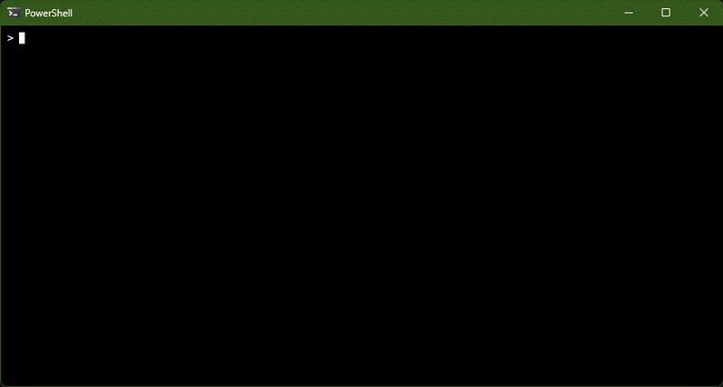
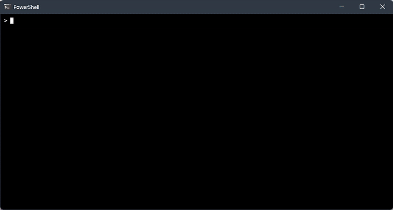
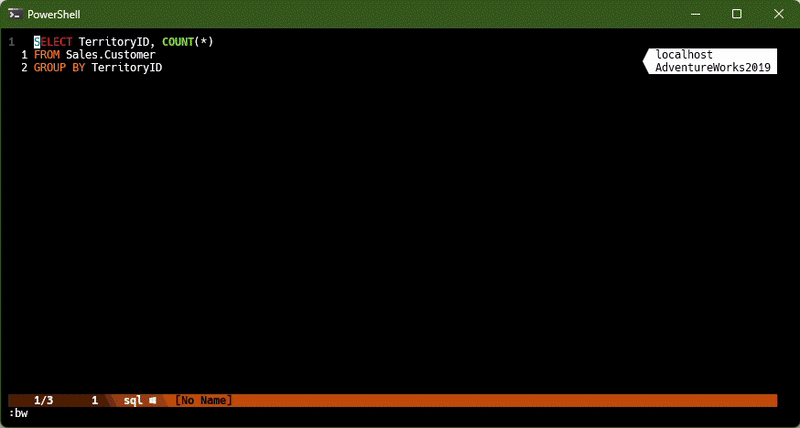
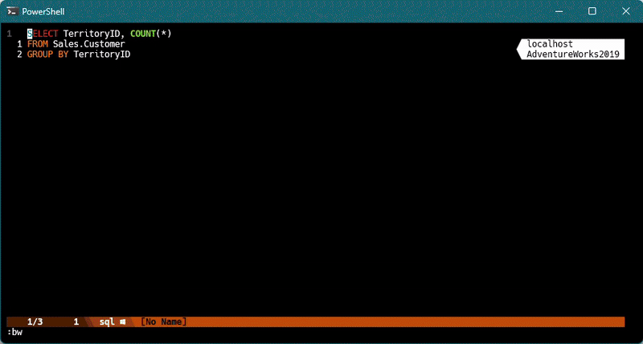

# sql.nvim
*A SQL client for SQL Server or PostgreSQL in Neovim*

## Contents

* [Overview](#overview)
* [Installation](#installation)
* [The :SQL Comand](#the-sql-command)
* [User Configuration](#user-configuration)
* [User State File](#user-state-file)
* [Buffers and Windows](#buffers-and-windows)
    * [*.sql Buffers](#sql-buffers)
    * [⟪SQLCatalog⟫ Buffer](#sqlcatalog-buffer)
    * [⟪SQLOut⟫ Buffer](#sqlout-buffer)
    * [Actions Pop-up Window](#actions-pop-up-window)
    * [Search Pop-up Window](#search-pop-up-window)
* [Examples](#examples)
    * [Configuration](#configuration)
    * [Basic Query](#basic-query)
    * [Exploring the Catalog](#exploring-the-catalog)
    * [Searching](#searching)
* [Dependencies](#dependencies)

## Overview

This plugin is a Neovim implementation of a very small portion of what SSMS does. Development started when [VsVim](https://github.com/VsVim/VsVim) did not work in SSMS; however, recent versions of SSMS and VsVim are compatible, so this plugin may be starting to fall into obsolescence. It is quite capable when using Windows or SQL Server authentication, but Microsoft Entra authentication will ask for credentials on every query execution.

Following is a list of the plugin's features. It will:

1. Connect to either SQL Server (using the classic version of `sqlcmd.exe`) or PostgreSQL databases (using `psql.exe`). Recent development has targeted only SQL Server, so there may be issues with PostgreSQL connections. (If so, submit an issue.)
1. Display a catalog window showing databases and their objects that exist in the configured servers.
1. Open an Actions popup on database objects to generate object-aware SQL scripts: `SELECT`, `INSERT`, `UPDATE`, `CREATE TABLE`, and more.
1. Open a Search popup to find under-the-cursor object names or entered patterns, jumping directly to matching catalog entries or an open buffer whose name matches.
1. Run an entire SQL script, or a paragraph or visual selection in it.
1. From the Output window, rerun the exact query that generated the output. This is useful for watching how data change in real time.
1. Format output results as Markdown tables, or as fixed-width tables with ASCII or Unicode borders.
1. The `:SQL` command provides additional functionality through its subcommands described below: `config`, `new`, `fmt:markdown`, `fmt:ascii`, `fmt:unicode`.

## Installation

Use your favorite plugin manager or manual method. No additional setup is required in your `.vimrc` or `init.lua`; however, there is a [separate JSON file](#user-configuration) that contains the list of servers and other connection parameters. Keeping that information in a different file keeps private data out of the Neovim config.

## The `:SQL` Command

The `:SQL` command takes exactly one of these required parameters.
* `config` - opens the userconfig file in a new window for modification.
* `new` - creates a new unnamed **SQL** buffer.
* `fmt:markdown` - formats the queries' output as Markdown tables.
* `fmt:ascii` - formats the queries' output with pipe characters and equal signs as borders
* `fmt:unicode` - formats the queries' output with Unicode box drawing characters as borders

## User Configuration
All the information about the servers and the platforms they're running is stored in a JSON file that you can edit with the `:SQL config` command. If the file doesn't exist, the plugin will create it in the Neovim data directory (`:echo stdpath('data').'\sql.nvim\userconfig.json`). It will look like this:

```json
{
    "REMOVE_ME": "This property causes `:SQL config` to run. Delete it to complete your config.",

    "_comment_": "See https://github.com/PhilRunninger/sql.nvim#user-configuration for instructions.",
    "sqlserver": {
        "servers": {
            "HOSTNAME": {
                "args": {
                    "-U": "user",
                    "-P": "password"
                },
                "order":1,
                "highlight": {"bg": "#800000", "fg": "white"}
            }
        },
        "delimiter": "\t",
        "alignLimit": 5
    },
    "postgres": {
        "servers": {
            "HOSTNAME": {
                "args": {
                    "-p": 5432
                }
            }
        }
    }
}
```

> [!IMPORTANT]
> The new file is created with a string property named `"REMOVE_ME"`, which acts as a signal to the plugin that the user configuration hasn't been completed yet. Be sure to remove the property before saving.

* The root object contains an object for each supported platform, currently just `"sqlserver": {...}` and `"postgres": {...}`. If one is not required, it can be removed. The default command lines are:
    * **sqlserver**: `sqlcmd -S <server> -d <database> -i <file> -s "<delimiter>" -W -I`
    * **postgres**: `psql -h <server> -d <database> -f <file> -F"<delimiter>" -A`
* Each `<platform>` object contains:
    * an optional `"delimiter"` string value. This is used as the delimiter between columns in the query results. The default is `"|"`, the pipe character.
    * an optional `"alignLimit"` numeric value. Query results come back with unaligned columns, and the plugin aligns them again. If the [EasyAlign](https://github.com/junegunn/vim-easy-align) plugin is used to do the alignment and the time estimate to do so exceeds this threshold, it is skipped. The default is `5` seconds. A value of `0` turns alignment off.
    * a **required** `"servers": {...}` object
* The `"servers"` object contains an object for each configured server.
* The `<server>` object contains:
    * an optional `"order"` integer value used to move favorite servers to the top, in ascending order.
    * an optional `"highlight"` object to define a highlight group for the server. You could use this to alert when you're on a production server. The following attributes are allowed: `"fg":string`, `"bg":string`, `"bold":boolean`, and `"italic":boolean`.
    * an optional `"args"` object of additional command-line arguments. Examples are: user ID, password, port, etc. To specify a switch that has no value, enter it like so: `{"-j": null}`. These additional arguments are appended to the command line.

## User State File

The plugin maintains a state file in the Neovim data directory (`:echo stdpath('data').'\sql.nvim\userstate.json`). This file contains the marks defined by the user, and the connection information for the 500 most recent SQL files, enabling quick resumption of work when reopening those files.

## Buffers and Windows

### `*.sql` Buffers
**SQL** buffers are where scripts are written. The `:SQL new` command will create a new buffer. Alternatively, you could open an existing file or set a buffer's filetype to `sql`. Many **SQL** buffers, and multiple windows for them, may exist at one time.

#### Buffer-local Mappings

* <kbd>F5</kbd> - Submits the whole file or the visual selection to the database.
* <kbd>Shift</kbd>+<kbd>F5</kbd> - Submits the current paragraph to the database.
* <kbd>Ctrl</kbd>+<kbd>F5</kbd> - Submits the BEGIN...END block surrounding the cursor to the database.
* Holding <kbd>Alt</kbd> down in combination with any of the above <kbd>F5</kbd> mappings will prompt for an alternative, this-time-only column delimiter.
* <kbd>F8</kbd> - Opens a window showing the servers' [catalogs](#sqlcatalog-buffer). [Actions](#actions-pop-up-window) done in the catalog will target the SQL buffer active when <kbd>F8</kbd> was pressed.
* <kbd>F3</kbd> - Opens the [Search popup](#search-pop-up-window).

### `⟪SQLCatalog⟫` Buffer
The `⟪SQLCatalog⟫` buffer shows the platforms and servers listed in the [user config](#user-configuration), and the databases and objects that are defined in them. This is where catalog browsing, searching, and object-aware SQL generation takes place. The window will appear on the left or right, depending on your `'splitright'` setting, and no other buffer is allowed in it.

#### Buffer-local Mappings

* <kbd>l</kbd> - Expands the tree one level, if the node is collapsed.
* <kbd>l</kbd> - Opens the [Actions popup](#actions-pop-up-window) for the database object under the cursor if the tree is fully expanded.
* <kbd>h</kbd> - Collapses the tree one level.
* <kbd>Enter</kbd> - Makes the SQL buffer target this database when running its queries.
* <kbd>F3</kbd> - Opens the [Search popup](#search-pop-up-window).
* <kbd>m</kbd> - Marks a database for quicker navigation, similar to Neovim marks.
* <kbd>dm</kbd> - Deletes a mark.
* <kbd>J</kbd> / <kbd>K</kbd> - Moves to bottom or top of current fold level.
* <kbd>q</kbd> - Closes the SQL Catalog window.
* <kbd>F5</kbd> - Refreshes the catalog. This is helpful after a CREATE, ALTER, or DROP, or after `:SQL config`.
* <kbd>F8</kbd> - Returns to the SQL buffer that opened the Catalog.

### `⟪SQLOut⟫` Buffer
The `⟪SQLOut⟫` buffer shows the output from running the SQL script. The window doesn't allow any other buffer in it, and will appear on the top or bottom, depending on your `'splitbelow'` setting.

#### Buffer-local Mappings

* <kbd>F3</kbd> - Opens the [Search popup](#search-pop-up-window).
* <kbd>F5</kbd> - Re-runs the last query.
* <kbd>F8</kbd> - Returns to the SQL buffer where the query is defined.

### Actions Pop-up Window
The **Actions** popup lists actions that are applicable to the type of object under the cursor, including `Preview`, `Select`, `Insert`, `Update`, `Create`, etc. Selecting one of these popup menu items creates a new script that will perform that action.

#### Buffer-local Mappings

* <kbd>h</kbd> - Close the **Actions** window.
* <kbd>l</kbd> - Generate the script for the selected action as a new buffer.
* <kbd>y</kbd> - Generate the script for the selected action, but put it in the unnamed paste buffer.

### Search Pop-up Window
Pressing <kbd>F3</kbd> first looks at the WORD (`:h WORD`) under the cursor, and tries to parse a *schema.object* pattern from it. **Search** then looks in the Catalog for that pattern, and for the word (`:h word`) under the cursor. If anything is found for either pattern, they are listed in the popup. Any open buffers that match the pattern(s) are listed as well. Finally, there is a way to manually enter a different pattern.

#### Buffer-local Mappings

* <kbd>h</kbd> - Close the **Search** window.
* <kbd>l</kbd> - If the cursor is on a buffer name, show that buffer; otherwise, go to the first matching line in the Catalog.
* <kbd>o</kbd> - Enter an alternative search string.
* <kbd>Enter</kbd> - An INSERT mode mapping, this initiates the search for the custom string entered with the <kbd>o</kbd> mapping.

## Examples

Here some different ways to use the plugin.

### Configuration

1. `:SQL config`
1. Enter the server(s) you need to work on and any other connection info needed to log in to them. This needs to be done only when adding or removing servers, or updating servers.



### Basic Query

1. `:SQL new` - Creates a new SQL file.
1. Write a query.
1. <kbd>F8</kbd> - Opens the catalog.
1. <kbd>l</kbd> - Expands the server's tree node.
1. Move cursor to the database where the query is to be run.
1. <kbd>Enter</kbd> - Links the server/database to the SQL file.
1. <kbd>F8</kbd> - Returns focus to the SQL file.
1. <kbd>F5</kbd> - Runs the query.
1. Inspect the results.
1. <kbd>F8</kbd> - Returns focus to the SQL file.
1. Modify the query.
1. <kbd>F5</kbd> - Runs the query.



### Exploring the Catalog

1. From a **SQL** file, <kbd>F8</kbd> - Opens the catalog.
1. Move cursor to and expand, with <kbd>l</kbd>, the desired server, database, and object type. This requires three separate tree expansions.
1. Scroll to the database object name.
1. <kbd>l</kbd> - Expands the tree, showing columns (tables and views) or parameters (functions and stored procedures).
1. <kbd>l</kbd> - Shows Actions popup for the selected object type.
1. Move cursor to the desired action.
1. <kbd>l</kbd> - Creates a new SQL script to do that action.



### Searching

1. From a **SQL** file, <kbd>F8</kbd> - Opens the catalog.
1. <kbd>l</kbd> - Expands the tree of applicable server and database. This populates the tree under the database, which is necessary for the search to work.
1. <kbd>F8</kbd> - Returns focus to the SQL file.
1. Put the cursor on the table name.
1. <kbd>F3</kbd> - Shows the Search popup. It will show the word under the cursor, and the schema.table derived from the WORD.
1. <kbd>l</kbd> - Jumps to the catalog where that table exists.



## Dependencies
- For running **sqlserver** queries, [sqlcmd.exe](https://learn.microsoft.com/en-us/sql/tools/sqlcmd/sqlcmd-utility?view=sql-server-ver16&tabs=go%2Cwindows&pivots=cs1-cmd) must be installed and in the path. NOTE: This is not the newer Go version.
- For running **postgres** queries, [psql.exe](https://www.postgresql.org/docs/current/app-psql.html) must be installed and in the path.

If the following optional plugins are installed, they will be used to format the results.
- [EasyAlign](https://github.com/junegunn/vim-easy-align) aligns the text into columns, if the output isn't too large.
- [mini.align](https://github.com/nvim-mini/mini.align) is a Lua alignment plugin that is much, much faster than **EasyAlign**. If both plugins are installed, this one will be used.
